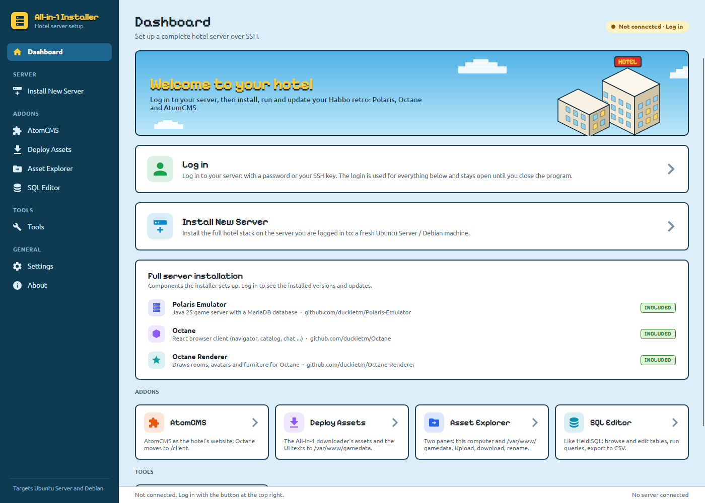
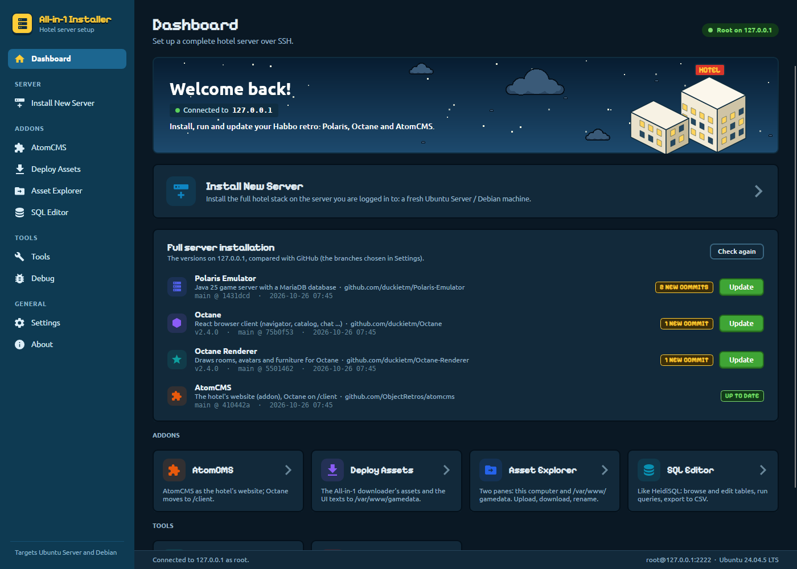
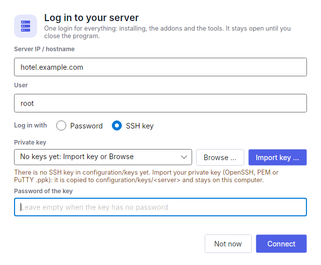
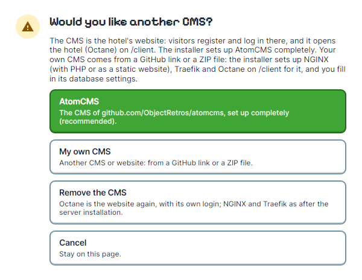
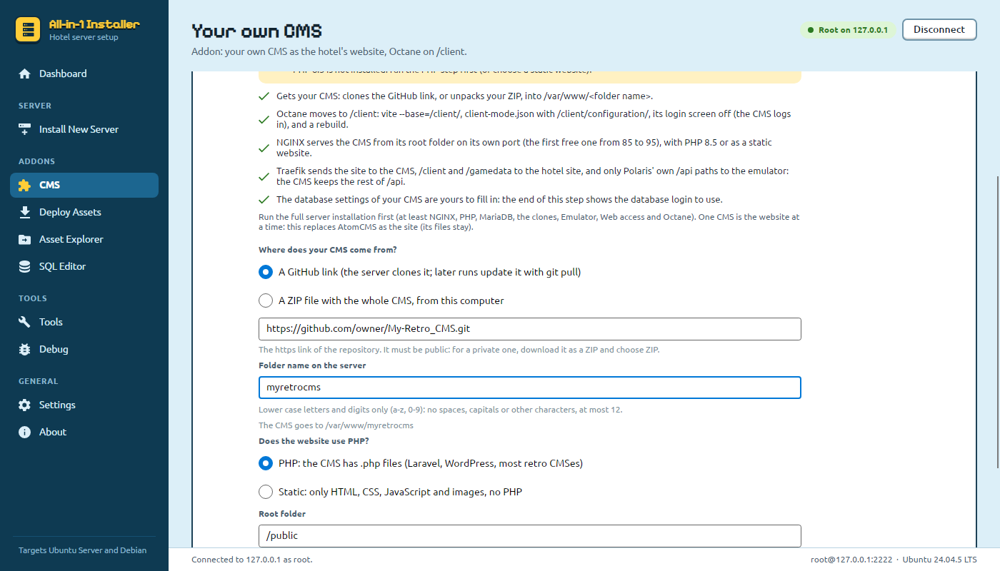
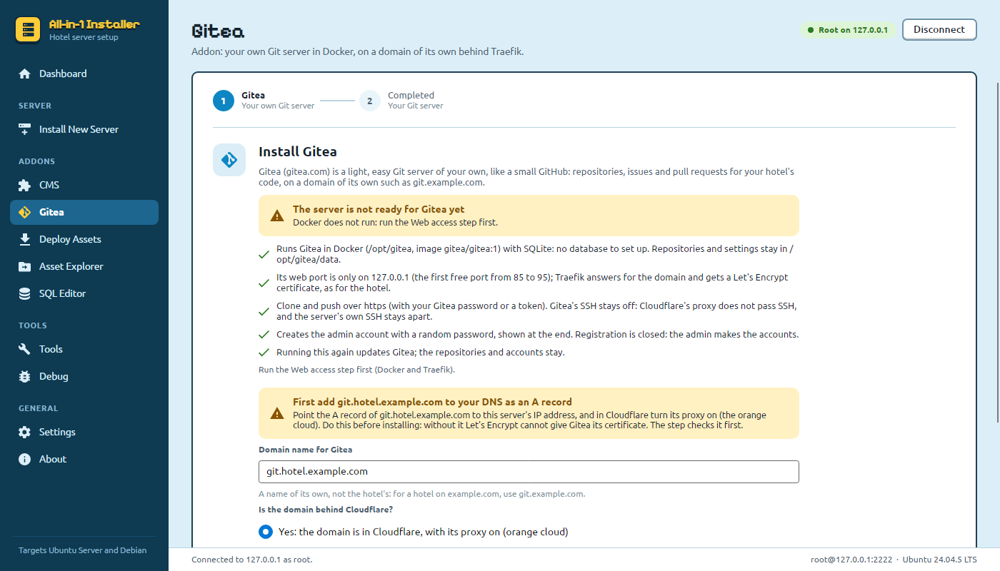
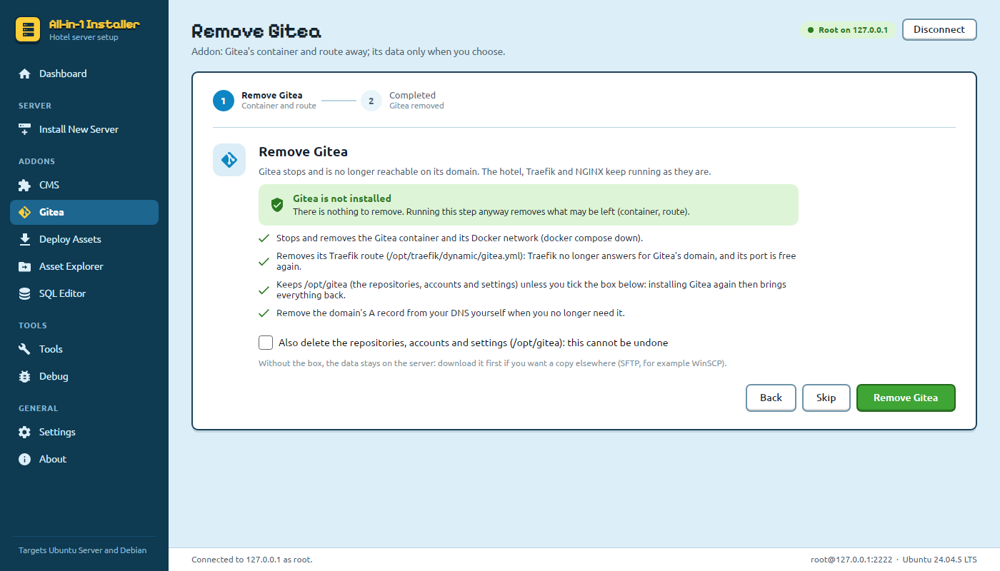
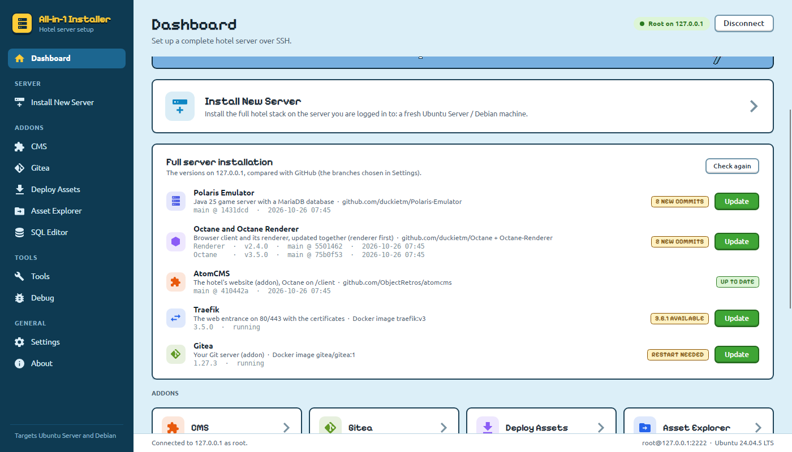
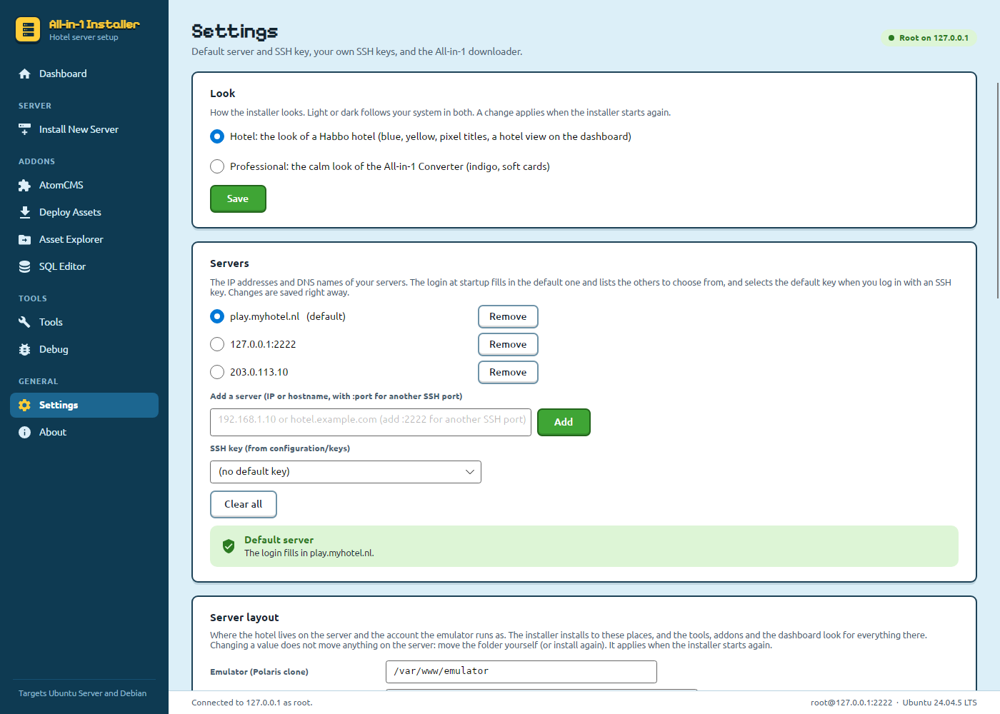

# All-in-1 Installer

A C# desktop installer that sets up a **full hotel server** on an **Ubuntu Server or Debian**
machine over SSH:

| Component | Repository |
|-----------|------------|
| Polaris Emulator (Java 25 game server + MariaDB) | <https://github.com/duckietm/Polaris-Emulator> |
| Octane (browser client) | <https://github.com/duckietm/Octane> |
| Octane Renderer | <https://github.com/duckietm/Octane-Renderer> |
| AtomCMS (addon, optional) | <https://github.com/ObjectRetros/atomcms> |

The GUI looks like a Habbo hotel: hotel-blue sidebar, the yellow of the hotel logo, green "go" buttons, panels with a
dark edge and a hard shadow like the hotel's windows, a hotel view on the dashboard (blue sky with outlined clouds by day, stars at night, and a hotel
scene), Ubuntu for text (as habbo.com and the client use) and Pixelify Sans for titles in the spirit of
the hotel's pixel font. Both fonts are free (Ubuntu Font Licence, SIL Open Font License) and ship in
`SourceCode/App/Fonts` with their licences. The sky and clouds are drawn by the installer itself; the hotel scene on
the right is `SourceCode/App/Images/hotel-view.png`, built into the program (replace that file to show another one). The layout (sidebar, cards, status pill, console log) comes from the
[All-in-1 Converter](https://github.com/duckietm/all-in-1-converter).

**Settings → Look** switches between this **Hotel** look and the **Professional** look of the All-in-1 Converter
(indigo, soft cards, Inter). It is stored in `configuration/settings.json` and applies at the next start; **Restart
now** starts the installer again right away (it waits while a step runs). Light or dark follows the system in both.



Once you are logged in, the dashboard's **Full server installation** card shows what is on the server: per component
the build version (the emulator's JAR, Octane's and the renderer's `package.json`), the branch, commit and date of
its clone, and whether GitHub has something new. That comes from the same `git fetch` as **Tools → Check for
updates** (right after logging in, and again after every update; **Check again** fetches once more), counted
against the branches chosen in **Settings → Repository branches**. A component that is behind gets
**N NEW COMMITS** and an **Update** button, which opens Tools and runs that update (Update emulator, Update Octane,
or Update AtomCMS) with its question and progress there. Octane and Octane-Renderer are updated and built together,
so both rows run Update Octane. AtomCMS gets a row of its own once it is installed.



## Requirements

**On your computer** (Windows 10/11 x64 or Linux x64), the installer needs **.NET 11**:

| How you run it | What to install |
|---|---|
| Published single file (`publish-win.bat` / `publish-linux.sh`) | Nothing: .NET is included in the file |
| A normal build (`bin/Debug/net11.0` or `bin/Release/net11.0`) | **.NET 11 Runtime** (the plain .NET Runtime; the Desktop and ASP.NET Core runtimes are not needed) |
| Building from source | **.NET 11 SDK** (includes the runtime) |

Download: **<https://dotnet.microsoft.com/download/dotnet/11.0>**. .NET 11 is at release candidate 2
(`11.0.100-rc.2`, supported for production use); the final release follows in November 2026. Any 11.0 SDK from
`11.0.100-rc.1` up works (`global.json` rolls forward). Check what is installed with `dotnet --list-sdks` and
`dotnet --list-runtimes`.

On Linux without a package, Microsoft's install script works too:

```bash
curl -fsSL https://dot.net/v1/dotnet-install.sh -o dotnet-install.sh
bash dotnet-install.sh --channel 11.0 --quality preview      # the SDK, into ~/.dotnet
export PATH="$HOME/.dotnet:$PATH"
```

**The server**: a fresh Ubuntu Server (22.04 or newer) or Debian (12 or newer) machine you can reach over SSH as
root or as a user with sudo rights. Everything else (NGINX, PHP, MariaDB, Java, Node.js, Docker ...) is installed
by the wizard.

## Status

**Step 1 – Logging in** (done)

When the program starts, it asks for the server first. **One login is used for everything**: Install New Server,
the addons and the tools. It stays open until you close the program or the server drops the connection.

1. **Server IP / hostname**: e.g. `192.168.1.10` or `hotel.example.com`. Add `:2222` for a different SSH port
   (`[::1]:2222` for IPv6).
2. **User**: `root`, or a user with sudo rights.
3. **Log in with**:
   - **Password**: also used for sudo when the account is not root, or
   - **SSH key**: a private key from `configuration/keys` (the default key from Settings, or else one in a folder
     named after the server, is selected), **Browse** for another file, or **Import key ...**: copies your private
     key (OpenSSH, PEM or PuTTY `.ppk`) to `configuration/keys/<server>/` with its public key next to it. Without any
     key in the configuration, the login says so and Import key is the highlighted button. The key and its password
     are checked on this computer before connecting; the key never leaves it. The user of a cloud image (`ubuntu`,
     `debian` ...) needs sudo without a password.

With your servers and a default key in **Settings**, the default server is filled in and the others are in the
server list to choose from (or type another one). **Not now** opens the program without a server:
the pages that need one show a **Log in** button, and so does the status at the top right (**Not connected · Log in**).
**Disconnect** (next to the status at the top right) closes the login, for example to log in to another server; it
waits while a step or tool is running.



Logging in:

- logs in over SSH (password, keyboard-interactive / PAM, or the SSH key),
- reads `/etc/os-release` and refuses anything that is not Ubuntu or Debian,
- switches to root when the user is not root:
  - passwordless sudo (`NOPASSWD`) is detected and used,
  - otherwise the password is sent to `sudo -S` over **stdin**, so it never shows up in `ps`,
  - a user that is not in the `sudo` group gets a clear error with the fix
    (`usermod -aG sudo <user>`),
- confirms root access by running `id -un` as root.

A failed login shows the reason in the login window, which stays open to try again. When the server drops the
connection (a reboot, a network problem), the installer notices within a few seconds and opens the login again,
filled in with the same server, user and key (never the passwords), as soon as no step is running.

Pages leave with **Back**, which returns to the dashboard and keeps the login open; a wizard continues where it was
the next time you open it. Logging in again (after a lost connection) starts the wizards over.

Every step uses `ServerConnection.RunAsRootAsync(...)`, which always runs as root: directly when logged in as root,
or through sudo. Files copied over SFTP into folders only root can open (the database backups) go through a private
staging folder in `/tmp` when the login is not root.

**Step 2 – SSH key for root** (done)

**Install New Server** starts with the SSH key step, which puts a key in `/root/.ssh/authorized_keys`, so the next
login can be root with that key. Choose one:

- **Generate a new key pair**: Ed25519 (recommended) or RSA 4096, in the standard OpenSSH format
  (works with `ssh`, SSH.NET, and PuTTYgen via *Conversions → Import key*). You must set a
  **key password** (at least 8 characters, typed twice). The private key is encrypted with it exactly
  like `ssh-keygen -N` does (aes256-ctr, bcrypt KDF with 16 rounds). The password is never stored and
  is cleared from the form after each run. The keys are saved in the **configuration directory** on
  this computer *before* anything changes on the server: `id_ed25519` (OpenSSH), `id_ed25519.pub`, and
  `id_ed25519.ppk`, the same key for PuTTY tools (plink in HeidiSQL, Pageant, WinSCP), encrypted with the same
  password. It is PPK version 2 (aes256-cbc, HMAC-SHA-1), which every PuTTY since 0.52 loads; version 3 would need
  Argon2. A key made before the `.ppk` existed can be converted with PuTTYgen (*Conversions → Import key*, then
  *Save private key*).
- **Use my own public key**: paste it or load a `.pub` file. The OpenSSH one-line format and the
  PuTTYgen `---- BEGIN SSH2 PUBLIC KEY ----` format both work. A pasted private key is refused.
  A copy of the public key is kept in the configuration directory.


If the server already has keys, the installer lists them (comment, type, fingerprint, and whether your
key is already one of them) and asks:

- **Clean all keys and place this one**: only the new key remains.
- **Add my key to it**: keeps the existing keys, so the server has several (no duplicates).
- **Abort installation**: changes nothing on the server. A key pair generated for this run is deleted again.


After an abort you choose **Abort** (leave the installation and go back to the dashboard; it starts over the next
time) or **Start over** (the SSH key step again). The login stays open either way.


Before every change, the old file is backed up on the server as
`/root/.ssh/authorized_keys.bak-<date>-<random>`. The installer writes `/root/.ssh` with mode 700
and `authorized_keys` with mode 600, both owned by root, and checks that the key ended up in the file.
For a generated key it then opens a second SSH session **as root with the new key** to prove it works.
If that fails, it reports why (for example `PermitRootLogin no` in sshd). The second session only
trusts the host key seen during the first login.


### The configuration directory

`configuration/` is created next to the installer (falling back to
`%LOCALAPPDATA%\All-in-1 Installer\configuration` or `~/.local/share/All-in-1 Installer/configuration`
when that folder is read-only). Keys are stored per server:

```
configuration/
  keys/
    <server>/
      id_ed25519              private key, encrypted with your key password (owner-only on Linux/macOS)
      id_ed25519.pub          public key
      provided_ed25519.pub    copy of a public key you provided
  database/
    <server>/
      mariadb.txt             MariaDB root, cms and emulator passwords (owner-only)
```

Existing files are never overwritten: a second key gets a timestamp, e.g. `id_ed25519_20261024-101500`.
**Keep this folder safe: it holds private keys and database passwords.** It is in `.gitignore`.

Log in later with the generated key (ssh asks for the key password):

```bash
ssh -i "configuration/keys/<server>/id_ed25519" root@<server>
```

**Step 3 – NGINX mainline** (done)

After the SSH key, **Next: NGINX** installs the web server:

1. **Check the server**: distribution, any installed NGINX, and what listens on port 80. If another
   program (Apache, ...) holds port 80, it stops here and nothing is changed.
2. **Add the nginx.org mainline repository**: `https://nginx.org/packages/mainline/<ubuntu|debian>`.
   The downloaded signing key must contain nginx.org's published key `573BFD6B3D8FBC641079A6ABABF5BD827BD9BF62`,
   and any key outside nginx.org's known set is refused. The repository is pinned (priority 900), so
   apt always takes NGINX from nginx.org.
3. **Install NGINX mainline** and check that the installed version really comes from nginx.org.
4. **Debian layout**: `nginx-common` itself can't be installed, because nginx.org's package declares
   `Conflicts/Replaces: nginx-common`, and the old repository that combined both (Ondřej Surý's) no
   longer exists. So the installer creates the same layout: `/etc/nginx/sites-available`,
   `sites-enabled` (included from `nginx.conf`), `snippets` and `proxy_params`. The nginx.org default site
   moves to `sites-available/default` and is enabled. On a server without IPv6 the `[::]:80` listen is
   disabled, because otherwise NGINX would not start.
5. **Start and test**: `nginx -t`, enable and start at boot, open 80/443 when `ufw` is active, and require
   HTTP 200 from `http://127.0.0.1/`.


If Ubuntu/Debian's own NGINX is installed, you choose **Replace it with NGINX mainline** (`/etc/nginx` is
saved to `/root/nginx-backup-<date>.tar.gz`, the old packages are purged, and the configuration starts fresh)
or **Abort installation**. If nginx.org's NGINX is already there, the step upgrades it and keeps your
`nginx.conf` changes. Running the step again is safe.


Long commands stream their output live into the log (`ServerConnection.RunAsRootStreamingAsync`).
**Copy log** in the top right corner of the log puts it on the clipboard, so a failure can be pasted into a
message instead of screenshotted. Select lines first to copy only those; Ctrl+C does the same. The button is
on every log in the program: the install steps, the connect page and the Tools.

Before every `apt-get update` the installer checks the **server clock** against the `Date` header of
`deb.debian.org`. A clock that is more than 2 minutes off is corrected and automatic time sync (NTP) is switched
on, because apt refuses repository files that seem to come from the future
(`Release file ... is not valid yet`).

**Step 4 – PHP 8.5 with PHP-FPM** (done)

After NGINX, **Next: PHP** installs:

```
php8.5-fpm php8.5 php8.5-common php8.5-mysql php8.5-xml php8.5-xmlrpc php8.5-curl php8.5-gd
php8.5-imagick php8.5-cli php8.5-mbstring php8.5-soap php8.5-zip php8.5-intl php8.5-bcmath unzip
```

PHP **8.5.12 or newer** is required because older releases have security problems. The installer refuses
to finish with an older version.

1. **Check the server**: installed PHP version, missing packages, other PHP versions (those are left alone).
2. **Add the repository** as in `packages.sury.org/php/README.txt`, which works for Debian (bookworm, trixie)
   and Ubuntu (jammy, noble, resolute). Before `dpkg -i`, the downloaded `debsuryorg-archive-keyring.deb`
   is unpacked and must hold Sury's key `15058500A0235D97F5D10063B188E2B695BD4743`. `php8.5*` is pinned to
   packages.sury.org, so an older distro 8.5 can never win.
3. **Install** the packages and require `PHP_VERSION` ≥ 8.5.12; `php` on the command line points to 8.5.
4. **Check** that all extensions load (`php8.5 -m`) and that `php-fpm8.5 -t` passes.
5. **Start PHP-FPM** at boot. When NGINX is installed: user `nginx` joins group `www-data` (owner of
   `/run/php/php8.5-fpm.sock`), `snippets/fastcgi-php.conf` is created (as in Debian's nginx-common), and a
   temporary site on `127.0.0.1:8085` must serve a PHP page through NGINX. The test site is removed afterwards.


In an NGINX site:

```nginx
location ~ \.php$ {
    include snippets/fastcgi-php.conf;
    fastcgi_pass unix:/run/php/php8.5-fpm.sock;
}
```

**Step 5 – MariaDB 12.3** (done)

After PHP, **Next: MariaDB** installs the database:

1. **Check the server**: an installed MariaDB (Ubuntu/Debian's or another mariadb.org version) is upgraded
   after you agree, and **all databases are first saved to `/root/mariadb-backup-<date>.sql.gz`**. If MySQL
   is installed, the step stops: MariaDB can't be installed next to it.
2. **Add the repository** `https://dlm.mariadb.com/repo/mariadb-server/12.3/repo/<ubuntu|debian>` (Ubuntu
   22.04/24.04/26.04, Debian 11/12/13). The signing key from `mariadb.org/mariadb_release_signing_key.pgp`
   must be `177F4010FE56CA3336300305F1656F24C74CD1D8`; the repository is pinned.
3. **Install MariaDB 12.3** and check that the *running* server is 12.3. A server still running the replaced
   old program (when package scripts may not restart services) is shut down cleanly first. Then
   `mariadb-upgrade` runs.
4. **Secure it**, with the same answers as your `mariadb-secure-installation`: unix_socket switch **n**, change
   root password **n**, remove anonymous users **Y**, disallow remote root **n**, remove test database **Y**,
   reload privileges **Y**. Then `bind-address = 0.0.0.0` in `/etc/mysql/mariadb.conf.d/50-server.cnf` (a backup
   of the file is kept). Port 3306 is **never** opened in the firewall: connect through an SSH tunnel (see Harden).
   `root@localhost` keeps its socket login and also accepts the root password, because a tunnel arrives from
   127.0.0.1, which MariaDB counts as `localhost`.
5. **Create the users and database** with **generated passwords** (32 letters and digits):
   ```sql
   root@'%'  -- ALL PRIVILEGES ON *.* WITH GRANT OPTION
   cms@'%'   -- EXECUTE, SELECT, SHOW VIEW, ALTER, ALTER ROUTINE, CREATE, CREATE ROUTINE, CREATE TEMPORARY TABLES,
             -- CREATE VIEW, DELETE, DROP, EVENT, INDEX, INSERT, REFERENCES, TRIGGER, UPDATE, LOCK TABLES ON habbo.*
   CREATE SCHEMA habbo;
   ```
   `root@localhost` keeps its socket login (no password) for administering MariaDB on the server itself.
   The SQL goes to the server over stdin, so the passwords never appear in a command line (`ps`), and
   password hashes are masked in the log.
6. **Test the logins**: root with its password over the network address (that is `root@'%'`), root locally
   over the socket, and cms remotely, over 127.0.0.1 and over the socket, including creating a table in `habbo`.


The passwords are saved **before** anything changes on the server, in
`configuration/database/<server>/mariadb.txt` (owner-only):

```
host=192.168.0.155
port=3306
database=habbo
root_user=root
root_password=...
cms_user=cms
cms_password=...
```

Running the step again reuses these passwords. If the users exist on the server but there is no saved file
(e.g. from another PC), new passwords are set and saved. The step says so before you install.

**Step 6 – Node.js 26, Composer and Yarn** (done)

After MariaDB, **Next: Node.js** installs the build tools, following your commands:

1. **Check the server**: Composer needs PHP, so without PHP the step stops before changing anything.
2. **Add NodeSource** `https://deb.nodesource.com/node_26.x nodistro main` with the key in
   `/etc/apt/keyrings/nodesource.gpg`. The key must be `6F71F525282841EEDAF851B42F59B5F99B1BE0B4` (NSolid), and
   `nodejs` is pinned to NodeSource.
3. **Install Node.js 26** (`apt-get install nodejs`, which includes npm) and check the major version.
4. **Install Composer**: the latest stable `composer.phar` from `getcomposer.org/download`, checked against its
   published SHA-256, to `/usr/bin/composer`. Not `composer-setup.php`: it downloads the phar itself without a
   timeout and can hang forever on a broken IPv6 route. All installer downloads use curl with timeouts and retry
   over IPv4.
5. **Install Yarn**: `npm install -g corepack`, `corepack enable`, and Yarn stable as the default outside
   projects. Each project uses the Yarn in its `package.json` (Octane: `yarn@4.18.0`).
6. **Check the versions**: `node`, `npm`, `yarn` and `composer --version`.


The step uses and tests the tools it installs in `/usr/bin`, also when an older `node`, `npm` or `composer`
(e.g. a hand-installed one in `/usr/local/bin`) comes first in root's `PATH`. Those older copies are reported
as a warning with their paths, so typing `node` really runs Node.js 26 after you remove them; the installer
does not delete them itself.


**Steps 7–9 – Clone Polaris, Octane and Octane-Renderer** (done)

| Step | Repository | Folder on the server |
|------|------------|----------------------|
| Polaris | https://github.com/duckietm/Polaris-Emulator | `/var/www/emulator` |
| Octane | https://github.com/duckietm/Octane | `/var/www/Octane` |
| Renderer | https://github.com/duckietm/Octane-Renderer | `/var/www/Octane-Renderer` |

Each step clones the full history (so `git pull` can update it later) and installs git first when needed. The
log keeps only the readable progress lines.

Every step has a **Branch** choice: **main** (stable, the version the hotel runs on) or **dev** (the newest
changes, not always stable). The choice is remembered per repository in `configuration/settings.json`, so the
next installation starts with it, and **Settings → Repository branches** sets the same thing for all three
without logging in to a server. The name is matched without case against the branches the repository really
has, because Polaris writes it as `dev` and Octane and the Renderer as `Dev`.

- **Folder missing or empty**: `git clone --branch <the branch you picked>`.
- **Folder already holds that repository** (`origin` matches, also as `git@github.com:...`): the step shows the
  branch, commit, locally changed files and new commits, and offers **Skip** or **Update (git pull)**. The update
  is `git pull --ff-only`, and it is refused when files tracked by git were changed, so local work is never lost.
  Is the clone on another branch than the one you picked? Then the step says so and switches to it
  (`git fetch` + `git checkout`) before pulling.
- **Folder holds something else** (other files, or a clone of another repository): **Move it aside and clone**
  renames it to `<folder>.bak-<date>` (nothing is deleted), or **Abort installation**.


**Step 10 – Build and run the Polaris emulator** (done)

After the clones, **Next: Emulator** builds `/var/www/emulator/Emulator` and runs it as a service. On the intro
page you choose:

- **Timezone** for `config.ini` (`serverTimezone`): a dropdown with every IANA timezone the server knows
  (`timedatectl list-timezones`; this computer's list when the server has none), each with its current UTC
  offset. Type the first letters to jump. Defaults to **Europe/Amsterdam**, or the timezone already in `config.ini`.
- **Memory** (`-Xmx`): 1–16 GB, defaulting to 4 GB (less on small servers; the server's RAM is shown).
- **Websocket whitelist** (`ws.whitelist`): hosts the client may connect from; add your hotel's domain
  (`hotel.com,*.hotel.com`). Polaris's default is `*` (any site); the installer replaces it.

What it does:

1. **JDK 25**: `openjdk-25-jdk-headless` (Ubuntu 22.04/24.04/26.04, Debian 13), or **Eclipse Temurin 25** from
   Adoptium (key `3B04D753C9050D9A5D343F39843C48A565F8F04B` checked) where the distribution has no OpenJDK 25
   (Debian 11/12). `pom.xml` requires JDK 25–26, so the scripts name that JDK explicitly; the server's default
   `java` is not changed.
2. **Account**: system user `emulator` (no login shell, home `/var/lib/emulator`), member of `www-data`. It owns
   `/var/www/emulator` and the log folder `/var/log/emu` (`2750 emulator:www-data`, so logs are group-readable).
3. **Build** with `/var/www/emulator/Emulator/build.sh`, run as `emulator`:
   ```sh
   ./build.sh               # mvn -B -ntp clean package -DskipTests -f pom.xml   (about 1 minute)
   ./build.sh --with-tests  # also the 4000+ unit tests                          (about 4 minutes)
   ```
   `pom.xml` requires Maven 3.9.11+, which is newer than apt's `maven` (3.8.7 on Ubuntu 24.04). The installer
   downloads the version the Maven Wrapper asks for (`.mvn/wrapper/maven-wrapper.properties`, now 3.10.0) to
   `/opt/apache-maven-<version>` itself: from Maven Central, else `dlcdn.apache.org` / `archive.apache.org`, with
   timeouts and an IPv4 retry, and checks the sha256 from that file. (`mvnw` downloads silently and without a
   timeout, which could hang the step forever.) `build.sh` falls back to `./mvnw` when that folder is missing.
   While Maven runs, the log shows a progress line every 30 seconds; the build is stopped after 30 minutes.
   The first build downloads about 150 MB of libraries to `/var/lib/emulator/.m2`. The JAR is now called
   `Polaris-<version>-jar-with-dependencies.jar`.
4. **Database account, config.ini, service**:
   - MariaDB account `emulator@localhost` with `ALL PRIVILEGES ON habbo.*` and a generated password, saved as
     `emulator_user` / `emulator_password` in `configuration/database/<server>/mariadb.txt` (sent over stdin).
   - `Emulator/config.ini` (`640 emulator:www-data`) from the repository's `config.ini.example`: `db.*` for the
     emulator account, `db.params=?characterEncoding=utf8&useSSL=false&serverTimezone=<your timezone>`, and
     generated secrets for `nitro.secure.master_key` and `login.remember.jwt.secret`. On a re-run only the
     database settings change; the rest of your `config.ini` is kept (with a `.bak-<date>` copy).
   - Start script `Emulator/emulator`: runs the newest JAR in `target/` with JDK 25 and your memory, logs to
     `/var/log/emu/emulator.log`, keeps the previous log as `emulator.log.<time>` (30 days).
   - `/etc/systemd/system/emulator.service`: `User=emulator`, `SupplementaryGroups=www-data`, after and requiring
     `mariadb.service`, `Restart=on-failure`, enabled at boot. `WorkingDirectory` is `Emulator/` (not `target/`),
     so `config.ini` survives `mvn clean`.
5. **Start**: the first start creates all database tables (Polaris migrations); then `console.mode = 0` and
   `ws.whitelist` (and the old `websockets.whitelist`) are set in `emulator_settings`, and it restarts when they
   changed. It waits for `Polaris has successfully loaded.` and checks port 3000 (opened in ufw when active).


```sh
systemctl status emulator          # running?
systemctl restart emulator         # after changing config.ini
tail -f /var/log/emu/emulator.log  # follow the log
cd /var/www/emulator/Emulator && sudo -u emulator ./build.sh && systemctl restart emulator   # rebuild
```

**Step 11 – Web access: Docker and Traefik** (done)

The step asks three questions:

1. **Do you use Cloudflare?** yes / no
2. **http or https?**
3. **The hotel's address**: a domain name (`example.com`) or an IP address. Typing `https://example.com/`
   also works: the scheme is taken from it.

https and Cloudflare need a domain name (Let's Encrypt gives no certificates for IP addresses).

What it sets up, for example for `https://example.com`:

```
https://example.com/...      Traefik (80/443) -> NGINX      http://127.0.0.1:85
https://example.com/ws       Traefik          -> Polaris    http://127.0.0.1:2096  (game websocket)
https://example.com/api/...  Traefik          -> Polaris    http://127.0.0.1:2096  (login, CMS API ...)
```

1. **Docker Engine** as on [docs.docker.com/engine/install/ubuntu](https://docs.docker.com/engine/install/ubuntu/)
   (and `/debian`): conflicting packages (`docker.io`, `podman-docker`, `containerd`, `runc` ...) are removed after
   you agree, the key `9DC858229FC7DD38854AE2D88D81803C0EBFCD88` is checked, `docker.sources` is added, and
   `docker-ce docker-ce-cli containerd.io docker-buildx-plugin docker-compose-plugin` are installed.
2. **NGINX** gets the site `/etc/nginx/sites-available/hotel` (`HotelSite.cs`; the Octane step writes the same
   file with its own root), modelled on a production Octane site:
   - `listen 127.0.0.1:85` only (so it is reachable through Traefik only), `server_name` with and without `www.`,
     `real_ip` from Traefik, `server_tokens off`, `autoindex off`, security headers (`X-Content-Type-Options`,
     `Referrer-Policy`, `Permissions-Policy`, and HSTS with https), logs in `/var/log/nginx/hotel/`;
   - `/configuration/` and `/.vite/manifest.json` never cached, hashed build files in `assets/` cached for a year;
   - `/gamedata/` from `/var/www/gamedata` (camera photos in `/gamedata/camera/`) and `/custom/` from
     `/var/www/gamedata/custom`, with CORS (and `OPTIONS` preflight) only for the hotel's own origin
     (`map $http_origin`), and images / `.nitro` / `.hab` cached for 30 days. `nginx` is added to the `www-data`
     group, so it can read the photos the emulator writes (mode 640, group `www-data`).

   The default site is disabled; another site that still listens on 80/443 stops the step with its file name.
3. **Traefik v3** in Docker (`/opt/traefik`): `compose.yaml` (host network, `restart: unless-stopped`),
   `traefik.yml`, `dynamic/hotel.yml` (the routes above) and `hotel.env` (your answers). With https, http
   redirects to https and the Let's Encrypt certificate (HTTP challenge) is renewed automatically. With
   Cloudflare, `X-Forwarded-For` is only trusted from Cloudflare's published IP ranges; without it, Traefik
   writes the header itself, so it cannot be faked. Ports 80 and 443 are opened in ufw when it is active.
4. **Polaris**: the address is added to `ws.whitelist` (websocket origins and CORS for `/api`), and
   `ws.ip.header = X-Forwarded-For`, so bans and rate limits see the visitor's IP; with Cloudflare also
   `ws.ip.header.trusted` = Cloudflare's ranges (see **The players' real IP behind Cloudflare** below). The emulator
   restarts when that changed. With Cloudflare the weekly refresh of Cloudflare's ranges is set up too.
5. **Test** on the server through Traefik: the site, `/api/health` and a websocket upgrade on `/ws` (101), and
   with https it waits up to 2 minutes for the certificate. Without a certificate the step ends with a warning
   that shows Let's Encrypt's error (usually: the domain does not point to this server yet, or port 80 is closed).


With Cloudflare: keep the DNS record **proxied** (orange cloud) and set SSL/TLS to **Full (strict)** for https.

```sh
cd /opt/traefik && docker compose logs -f traefik        # Traefik log (certificates, routing errors)
cd /opt/traefik && docker compose pull && docker compose up -d   # update Traefik
```

**Step 12 – Octane client** (done)

Uses the address from the web access step; nothing to fill in. For `https://example.com`:

1. `yarn install` in `/var/www/Octane-Renderer`, then in `/var/www/Octane` (Node.js 26 and Yarn 4 from `/usr/bin`).
2. In `/var/www/Octane/public/configuration`, `client-mode`, `hotlooks`, `infostand_backgrounds`, `news`,
   `renderer-config` and `ui-config` `.json` are created from the `.example` files (existing files are kept), and
   the URL keys are set (an existing file that changes is saved as `.bak-<time>` first):

   | File | Keys |
   |---|---|
   | `renderer-config.json` | `socket.url` = `wss://example.com/ws` (`ws://` with http), `api.url` = `https://example.com`, `asset.url` = `https://example.com/gamedata`, `image.library.url` = `…/gamedata/c_images/`, `hof.furni.url`, `furni.asset.icon.url` = `…/gamedata/icons/…`, `badge.asset.group.url` = `…/gamedata/c_images/groupbadge/badge/%badgedata%`, `badge.asset.grouparts.url` = `…/gamedata/c_images/groupbadge/badgeparts/badgepart_%part%.png`, `group.badge.url` = `%imagerdata%`, `habbicons.asset.root` = `/habbicons` (`/client/habbicons` with AtomCMS: the icons are in Octane's own build) |
   | `ui-config.json` | `camera.url` = `https://example.com/gamedata/camera`, `thumbnails.url` = `…/gamedata/camera/thumb/%thumbnail%.png`, `camera.render.mode` = `upload` |
   | `client-mode.json` | `apiBaseUrl` = `https://example.com`, `plainConfigBaseUrl` = `…/configuration/`, `plainGamedataBaseUrl` = `…/gamedata/` |

   A new file also gets `timezone.settings` from the emulator's
   timezone, and in `client-mode.json` obfuscation, secure assets and secure API off.
3. **`/var/www/gamedata`**: every folder those URLs point to is created (`config`, `furniture`, `clothes`,
   `effect`, `pets`, `room`, `icons`, `c_images/album1584`, `c_images/catalogue`, … 26 in all), owned by
   `www-data` with the group sticky (`2775`). **The assets themselves are not copied**: put them there with the
   All-in-1 download tool. The emulator writes into it as well (custom badges into `c_images/album1584`,
   `users_custom_badge_settings.badge_path`; furni editor changes into `config/*.json`), so
   `/usr/local/sbin/gamedata-permissions` gives the `www-data` group read/write access with **default ACLs**: files
   copied in later as root or another user stay writable for the emulator and readable for NGINX. Run it again if
   an upload tool reset the permissions. `news/news.json` (the login screen's news, `login.news.url`) gets a "Welcome to <address>!"
   message when it does not exist yet; your own news is never overwritten.
4. `yarn build` (and `/var/www/Octane/build.sh`, which runs both `yarn install`s and the build again: use it after
   changing the configuration or after a `git pull`).
5. The hotel site is written again with `root /var/www/Octane/dist` (also when it came from an older version of
   the web access step), and the step checks through Traefik that
   `index.html` and `configuration/renderer-config.json` are served.

6. **Camera and badge imager**: in the emulator's `emulator_settings` (the emulator is stopped while they are written, then started
   again; nothing happens when they are already set):

   | Key | Value |
   |---|---|
   | `camera.url` | `https://example.com/gamedata/camera/` |
   | `imager.location.output.camera` | `/var/www/gamedata/camera` |
   | `imager.location.output.thumbnail` | `/var/www/gamedata/camera/thumb/` |
   | `camera.render.mode` | `auto` |
   | `imager.location.output.badges` | `/var/www/gamedata/c_images/album1584/` |
   | `imager.location.badgeparts` | `/var/www/gamedata/c_images/groupbadge/badgeparts/` |

   The folders (`camera`, `camera/thumb`, `c_images/album1584`, `c_images/groupbadge/badge` and `badgeparts`) are
   created for the `www-data` group.

```sh
nano /var/www/Octane/public/configuration/ui-config.json   # e.g. hotel.name
/var/www/Octane/build.sh                                   # rebuild dist/ with it
```

**Step 13 – Harden the server** (done)

Nothing to fill in.

1. **Polaris** (the emulator is stopped while they are written, then started again):
   `ws.whitelist` = only the hotel's address (`example.com`; Polaris drops `www.` itself), the old
   `websockets.whitelist` the same, and `ws.ip.header` = `X-Forwarded-For`.
   That header is right **with Cloudflare too**, with `ws.ip.header.trusted` = Cloudflare's ranges and the same
   ranges for NGINX (see **The players' real IP behind Cloudflare** below).

   **The players' real IP behind Cloudflare.** Cloudflare sends `X-Forwarded-For: <player>`; Traefik trusts that
   only from Cloudflare's ranges and appends the Cloudflare address it saw: `<player>, <Cloudflare>`. Polaris and
   NGINX read the header **from the right** and skip only the proxies they trust (a visitor can write anything on
   the left, so that is the only safe way), so both must trust Cloudflare's ranges, or every player shows up as a
   Cloudflare address (`logged in from IP 172.71.x.x using proxyserver 127.0.0.1`). The installer gives Polaris
   `ws.ip.header.trusted` = Cloudflare's ranges, and NGINX `/etc/nginx/hotel-real-ip.conf` (`set_real_ip_from`
   127.0.0.1 and Cloudflare's ranges, with `real_ip_header X-Forwarded-For` and `real_ip_recursive on` in the hotel
   site). `CF-Connecting-IP` is not used on purpose: Traefik passes it through unchanged, so anyone reaching the
   server without Cloudflare could write their own. Cloudflare changes its ranges now and then, so
   `/var/scripts/CF_Refresh.sh` runs every Sunday at 04:00 from `/etc/cron.d/cf-refresh` (output in
   `/var/log/cf-refresh.log`): it rewrites NGINX's list (a graceful reload), and Traefik's and Polaris' only when the
   ranges really changed (Traefik is restarted, the emulator stopped and started, because it writes its settings
   back when it stops). On an existing server, **Tools → Fix visitor IPs** does all of this at once.
2. **MariaDB over an SSH tunnel**: 3306 stays closed; HeidiSQL and the like use your SSH key. A tunnel arrives
   from 127.0.0.1, which MariaDB counts as `root@localhost` (socket login only), so that account also gets the
   saved root password (`IDENTIFIED VIA unix_socket OR mysql_native_password`). In HeidiSQL: network type
   **MariaDB or MySQL (SSH tunnel)**; on the *SSH tunnel* tab `plink.exe`, the server, port, user and the **`.ppk`**
   (plink only reads PuTTY keys; it cannot ask for the key password inside HeidiSQL, so load the `.ppk` in
   **Pageant** first, and log in once with PuTTY to accept the host key), SSH timeout about 10 seconds; on the
   *Settings* tab host `127.0.0.1`, user `root` or `cms` with the password from
   `configuration/database/<server>/mariadb.txt`.
3. **TCP stack** in `/etc/sysctl.conf` (a `.bak-<time>` copy first; existing lines for these keys are replaced) and
   applied right away: `net.ipv4.tcp_syncookies=1`, `net.ipv4.tcp_max_syn_backlog=2048`,
   `net.ipv4.tcp_synack_retries=3`.
4. **Firewall (ufw)**, from a clean rule set (ufw keeps the old rules as `/etc/ufw/*.rules.<date>`):
   ```
   ufw default deny incoming
   ufw default allow outgoing
   ufw limit <ssh port>/tcp comment 'Rate limit for openssh server'   # every port sshd uses + the one you are on
   ufw allow 80/tcp, 443/tcp                                          # or, with Cloudflare, only from its IP ranges
   ufw --force enable
   ```
   MariaDB (3306) and the emulator's ports (3000, 2096) stay closed: the game runs through Traefik on `/ws`. Traefik runs in Docker
   with the host network, so Docker publishes no ports past ufw. Without IPv6 only Cloudflare's IPv4 ranges are
   used. `/etc/ufw/all-in-1-hardened` marks the firewall as managed: the NGINX, MariaDB, Emulator and Web access
   steps then no longer open ports themselves.
   **Firewall log**: `ufw logging` is switched on (low) when it was off, and in `/etc/rsyslog.d/20-ufw.conf` the last
   line `#& stop` becomes `& stop` (added when missing), so the firewall's messages go only to `/var/log/ufw.log`
   instead of also filling `kern.log` and `syslog`; then rsyslog is restarted. Without rsyslog (Debian 12 keeps only
   the journal) the messages stay in the journal. **Debug → Firewall** shows the log live. A server hardened before
   this counts as not done yet, so the step offers **Apply again**.
5. **Log in again**: a new SSH login through the firewall proves you are not locked out (the current session stays
   open; if it fails, the step says so and `ufw disable` undoes it).

**Step 14 – SSH login: keys only (optional)**

After Harden. You choose: **Keep password login** (changes nothing, or allows passwords again), or **Turn password
login off: only SSH keys can log in**. A warning says what that means: lose your key and the only way in is the
console of your hosting provider (KVM / VNC / rescue). You have to tick that you understand it. With keys only, the
step:

1. checks that one of your keys on this computer is in root's `authorized_keys` (the SSH key step puts it there),
2. logs in as root with the key in a separate session (the key password goes in the field): when that fails, nothing changes,
3. writes `/etc/ssh/sshd_config.d/00-all-in-1-keys-only.conf` (`PasswordAuthentication no`, `KbdInteractiveAuthentication no`,
   `PermitRootLogin prohibit-password`); it makes sure `sshd_config` includes `sshd_config.d`, checks with `sshd -t`, reloads sshd
   (open sessions stay connected) and checks the effective values with `sshd -T`,
4. logs in with the key again; when that fails, password login is put back automatically. A password login is tried
   as well, and should now be refused.

To allow passwords again: run the step with **Keep password login**, or delete that file on the server console and
reload ssh.


**Completed – upload the assets** (done)

After the last step (done or skipped) the wizard shows **Successfully completed** (or *Completed, with steps to look
at* when a step was skipped or failed), with what every step did, and then:

1. Download all assets with the **All-in-1 downloader**.
2. Upload them with **WinSCP**: SFTP, the server and SSH port, user `root`, the `.ppk` key from the configuration
   folder (*Advanced… → SSH → Authentication*), into `/var/www/gamedata/`.
3. Where everything goes:

   | Folder in `/var/www/gamedata` | Contents |
   |---|---|
   | `config/` | FurnitureData.json, ProductData.json, FigureData.json, FigureMap.json, EffectMap.json, HabboAvatarActions.json, ExternalTexts.json, UITexts.jsonc |
   | `furniture/` | furniture bundles (&lt;name&gt;.hab) |
   | `clothes/` | clothing bundles (&lt;name&gt;.hab) |
   | `effect/` | avatar effect bundles (&lt;name&gt;.hab) |
   | `pets/` | pet bundles (&lt;name&gt;.hab) |
   | `bundled/generic/` | generic bundles (&lt;name&gt;.hab) |
   | `room/` | room bundles (room/&lt;name&gt;/&lt;name&gt;.json) |
   | `icons/` | furniture icons (&lt;name&gt;_icon.png) |
   | `images/` | loading_icon.png, clear_icon.png, big_arrow.png, reception/ (hotel view), wallet/ (currency icons) |
   | `sounds/` | sounds (&lt;sample&gt;.mp3, sound_machine_sample_&lt;n&gt;.mp3) |
   | `c_images/album1584/` | badges (&lt;code&gt;.gif); custom badges are added here by the emulator |
   | `c_images/catalogue/` | catalogue headers and icons |
   | `c_images/reception/` | login screen images |
   | `c_images/notifications/, Quests/, fx_icons/, habboway/, web_promo_small/, album1358/` | notification, achievement, effect and promo images |
   | `c_images/groupbadge/badgeparts/` | group badge parts (badgepart_&lt;part&gt;.png) |
   | `habbopages/` | the hotel's help/info pages |
   | `custom/` | your own extra files (served as /custom/) |
   | `news/news.json` | login screen news (the welcome message is already there) |
   | `camera/, c_images/groupbadge/badge/` | filled by the emulator: do not upload |

4. After uploading: `sudo /usr/local/sbin/gamedata-permissions` (write access for the emulator), open the hotel
   (**Open &lt;url&gt;** button), register the first account, log out and make it administrator:
   ``UPDATE users SET `rank` = 7 WHERE username = 'YourName';`` (HeidiSQL over the SSH tunnel).


### Running the installer again

Every install step first checks the server and shows what it found:

| Step | Counts as already installed when | Buttons |
|------|----------------------------------|---------|
| SSH key | a public key saved in `configuration/keys/<server>/` is in `/root/.ssh/authorized_keys` | **Skip (already installed)** · Install another key |
| NGINX | NGINX from nginx.org is installed and `nginx.conf` includes `sites-enabled` | **Skip (already installed)** · Reinstall / upgrade |
| PHP | all packages installed, PHP ≥ 8.5.12 and PHP-FPM running | **Skip (already installed)** · Reinstall / upgrade |
| MariaDB | 12.3 from mariadb.org running on 0.0.0.0, users and `habbo` exist, and the saved cms password works | **Skip (already installed)** · Reinstall / upgrade |
| Node.js | Node.js 26 from NodeSource, Yarn and Composer in `/usr/bin` | **Skip (already installed)** · Reinstall / upgrade |
| Polaris / Octane / Renderer | the folder is a clone of that repository, on the branch picked under **Branch** | **Skip (already installed)** · Update (git pull) |
| Emulator | JDK 25, the `emulator` account, a built JAR, `config.ini`, and the emulator running | **Skip (already installed)** · Rebuild and restart |
| Web access | Docker from download.docker.com running, the Traefik container running, the hotel site on 127.0.0.1:85 | **Skip (already installed)** · Set up again |
| Harden | ufw active with deny incoming and no 3306 rule, the TCP settings in `/etc/sysctl.conf`, `ws.whitelist` = the hotel's address and `ws.ip.header` = `X-Forwarded-For`; with Cloudflare also `ws.ip.header.trusted` and NGINX's real-IP file with Cloudflare's ranges | **Skip (already installed)** · Apply again |
| SSH login | sshd -T says no password and no keyboard-interactive login | **Skip (already installed)** · Apply again |
| Octane | `dist/` built and served, `/var/www/gamedata` exists, `socket.url` matches the web access address, the camera URLs are set (ui-config and emulator) and `plainConfigBaseUrl` matches the layout (`/configuration/`, or `/client/configuration/` with AtomCMS) | **Skip (already installed)** · Configure and rebuild |
| AtomCMS (addon) | `vendor/` and the atom theme are built, AtomCMS' tables exist, the hotel site's root is `/var/www/atomcms/public` and `hotel.env` has `CMS=atom` | **Skip (already installed)** · Update and rebuild |

When a step is not done yet, the install button is the highlighted one and **Skip** is next to it
(for example, to keep using the password instead of a key). Skipping changes nothing on the server.
Skipping a step moves on to the next one, and a failed step can be skipped too.


A new step is a class derived from `InstallStep`, added to `ServerWizard.ServerSteps()`. An addon is a
`ServerWizard` with its own step list and finish page (and `keyStep: false`), plus a sidebar entry in `InstallerWindow`.

## Addons

The sidebar has an **ADDONS** section for things that go on top of a finished server installation.
The addons and Tools use the login from the start of the program: there is no separate login per page. **Back**
returns to the dashboard and keeps the login (and the SQL Editor's database connection) open.

### CMS

**Addons → CMS** first asks **Would you like another CMS?**: **AtomCMS** (set up completely, below), **My own
CMS** (from a GitHub link or a ZIP file, see [Your own CMS](#your-own-cms)) or **Remove the CMS** (see
[Removing the CMS](#removing-the-cms)). Both work the same way for the hotel: the
CMS is the website and Octane moves to **/client**, and both need a finished server installation. One CMS is the
website at a time; switching keeps the other one's files.



**Ports.** Every CMS gets its own NGINX site (`/etc/nginx/sites-available/cms-<name>`) on 127.0.0.1, on the first
free port from **85 to 95** (85 is the hotel site, so usually 86); a CMS keeps its port when the addon runs again.
Traefik sends `/ws` and Polaris' own `/api` paths to Polaris, `/client`, `/gamedata` and `/custom` to the hotel site
on port 85, and the rest of the address to the CMS. `/opt/traefik/hotel.env` remembers the CMS (`CMS`, `CMS_NAME`,
`CMS_PORT`), so the Web access and Octane steps keep this layout when they run again. The CMS' log lines go to the
hotel site's logs, so **Debug → NGINX** shows them. An AtomCMS set up before CMSes had their own port keeps working
as it was (served by the hotel site); running the AtomCMS addon again moves it to its own port.

### AtomCMS

[AtomCMS](https://github.com/ObjectRetros/atomcms) becomes the hotel's website: visitors register and
log in on the CMS, and the CMS opens Octane on **/client** with an SSO ticket. This automates
[NGINX_Atom_setup.md](https://github.com/duckietm/Complete-Retro-on-Ubuntu/blob/main/NGINX_Atom_setup.md),
adapted to this installer's layout. Run the full server installation first, from the same computer
(the database login comes from `configuration/database/<server>/mariadb.txt`).


It asks for the hotel's name, then:

1. **Clone or update** `https://github.com/ObjectRetros/atomcms` in `/var/www/atomcms` (git pull on a re-run).
2. **.env** from `.env.example` (the old one is kept as `.env.bak-<time>`): `APP_NAME`, `APP_ENV=production`,
   `APP_DEBUG=false`, `APP_URL`, MariaDB on 127.0.0.1 with the `cms` account, `FORCE_HTTPS` and
   `SESSION_SECURE_COOKIE` for https, `RCON_PORT` from the emulator's `config.ini`.
3. **composer install** (with the dev packages: AtomCMS' seeder uses Faker on an empty `users` table).
4. **Database**: `php artisan key:generate` (once), `storage:link`, `migrate --seed` on the first install
   (only `migrate` later). AtomCMS handles the emulator's own `password_resets` table itself, and only adds
   columns with defaults to `users` and `camera_web`. On the first install the website settings are set for
   this server:

   | Setting | Value |
   |---|---|
   | `theme` | `atom` |
   | `nitro_path` | `/client` |
   | `nitro_external_texts_file` | `/var/www/gamedata/config/ExternalTexts.json` |
   | `badges_path` / `badge_path_filesystem` | `/gamedata/c_images/album1584` / `/var/www/gamedata/c_images/album1584` |
   | `group_badge_path` | `/gamedata/c_images/groupbadge/badge` |
   | `furniture_icons_path` | `/gamedata/icons` |
   | `ads_picture_path` / `ads_path_filesystem` | `/gamedata/custom` / `/var/www/gamedata/custom` |
   | `rcon_ip` / `rcon_port` | `127.0.0.1` / the emulator's `rcon.port` |

5. **Theme**: `npm ci` and `npm run build:atom` (the atom theme and the housekeeping).
6. **Octane on /client**: in `package.json` (the change from the guide)

   ```json
   "start": "vite --base=/client/ --host",
   "build": "vite --base=/client/ build && node scripts/minify-dist.mjs",
   ```

   `client-mode.json` gets `plainConfigBaseUrl` = `<url>/client/configuration/` (`plainGamedataBaseUrl` stays
   `<url>/gamedata/`, `apiBaseUrl` stays `<url>`, through Traefik), `renderer-config.json` gets
   `"login.screen.enabled": false` and `"habbicons.asset.root": "/client/habbicons"`, and Octane is rebuilt. `build.sh` puts the `--base` back after a git pull,
   and the Octane clone step undoes only that change before it pulls.
7. **NGINX and Traefik**: AtomCMS' own NGINX site serves `/var/www/atomcms/public` (PHP 8.5 through PHP-FPM) on a
   free port (see Ports above); the hotel site keeps Octane's `dist/` on `/client/` and `/gamedata/`. AtomCMS has an
   `/api` of its own, so Traefik sends only Polaris' paths to the emulator: `/ws`, `/nitro-sec` and
   `/api/{auth,authx,badges,cms,emustats,health,housekeeping,maintenance,public,wired}`.
   `/opt/traefik/hotel.env` gets `CMS=atom` and the port.
8. **Test** through Traefik: the CMS, `/client/`, AtomCMS' `/api/online-count` and Polaris' `/api/health`.
9. **Installation key**: AtomCMS makes the key for its web installer on the first visit, so the step opens
   `/installation` and reads the key from `website_installation` (adding one itself if there is none). The key
   is printed in the log, and shown under the result with a **Copy** button.

The last page shows the installation key with a **Copy** button, to paste in **AtomCMS' web installer**, and the
settings above, which the installer already has filled in. Register your account on the CMS and make it
administrator (``UPDATE users SET `rank` = 7 WHERE username = 'YourName';``); the housekeeping is on `/housekeeping`.
Captcha keys (Turnstile / reCAPTCHA) go in `/var/www/atomcms/.env`. To update AtomCMS later, run the addon again.


### Your own CMS

**Addons → CMS → My own CMS** makes your own CMS (or any website) the hotel's website, the same way as AtomCMS: the
CMS on the site, Octane on **/client** (with `--base=/client/`, `/client/configuration/` and its login screen off,
because the CMS logs in), and only Polaris' own `/api` paths to the emulator. It asks:

- **Where it comes from**: a **GitHub link** (`https://github.com/owner/cms.git`; the server clones it, and a later
  run updates it with `git pull`) or a **ZIP file** from this computer. A private repository cannot be cloned: the
  step says so instead of waiting for a password; download it as a ZIP then. A ZIP with one folder at the top (like
  GitHub's **Download ZIP**) is unpacked without that extra folder.
- **Folder name**: the CMS goes to `/var/www/<name>`. Lower case letters and digits only, at most 12 (from a GitHub
  link it is filled in with the repository's name). Names of the hotel's own folders are refused.
- **PHP or static**: PHP gets PHP 8.5 through PHP-FPM, like AtomCMS; a static website (HTML, CSS, JavaScript) is
  served as files.
- **Root folder**: the folder inside the CMS with the start page (`index.php` / `index.html`), which visitors'
  browsers get; everything outside it (such as the settings with passwords) stays hidden. Laravel-based CMSes use
  `/public`; when the start page is in the top folder, enter `/`. A root that does not exist is refused, with the
  folders that are there.

A folder that already has other content is moved aside (`<folder>.bak-<date>`, nothing is deleted) when you choose to.
The folder belongs to `www-data`. Then Octane is rebuilt for `/client`, the CMS gets its own NGINX site (see Ports
above) and Traefik its route, and the CMS, `/client/` and Polaris' `/api/health` are tested through Traefik (an error
page of the CMS is fine at this point: its database is not set yet).

**The database is yours to set up**: the installer cannot know the settings of a CMS it does not know. The last page
shows the login to use: the **cms** account the server installation made (host 127.0.0.1, port 3306, the hotel
database, the user and its password, from `configuration/database/<server>/mariadb.txt`), never root. Packages your
CMS needs (`composer install`, `npm run build`) run in **Tools → SSH terminal**, in the CMS folder.



### Removing the CMS

**Addons → CMS → Remove the CMS** sets the hotel back to how the server installation left it:

1. **Octane on /** again: `vite` without `--base`, `client-mode.json` with `<url>/configuration/`,
   `habbicons.asset.root` back to `/habbicons`, Octane's own **login screen on** again (with a CMS the CMS logs
   players in, so it was off), and a rebuild. The hotel is unavailable for about a minute while it builds.
2. **NGINX**: the hotel site on 127.0.0.1:85 serves Octane on `/` again, and every CMS site (`cms-*`) is disabled.
3. **Traefik**: `/ws` and all of `/api` go to Polaris again, the rest to the hotel site; `hotel.env` gets `CMS=none`.
4. **Test** through Traefik: the site, Polaris' `/api/health` and the websocket.

The CMS' files stay, unless you tick **Also delete the CMS' folder and its NGINX site file**. Its database tables
(such as AtomCMS' `website_*` tables) and the users stay in the hotel database. A CMS again: **Addons → CMS**.

### Gitea

**Addons → Gitea** installs [Gitea](https://gitea.com), a light and easy Git server of your own (repositories,
issues, pull requests: a small GitHub), in Docker behind the hotel's Traefik, following Gitea's
[reverse proxy guide](https://docs.gitea.com/administration/reverse-proxies/). Run the Web access step first.

It asks for:

- **The domain**, a name of its own: for a hotel on `example.com`, `git.example.com` (filled in for you).
- **Cloudflare** yes or no (filled in with the hotel's choice).
- **The admin account**: a name (Gitea keeps `admin` for itself, so `gitadmin` is filled in) and an e-mail address.

> **First add the domain to your DNS as an A record** pointing to the server, and with Cloudflare turn its **proxy on**
> (the orange cloud). Without it Let's Encrypt cannot give Gitea its certificate. The step checks the DNS first: no
> address stops it; Cloudflare chosen but the proxy off (or the other way round) gives a warning.

What it sets up:

- **Docker** in `/opt/gitea` (`compose.yaml`, `.env`, `data/`), image `gitea/gitea:1`, with SQLite: no database to set up.
  Gitea has a Docker network of its own (the image always starts an SSH server inside, which must not meet the
  server's SSH), and only its web port is published, on **127.0.0.1**, on the first free port from 85 to 95 (the
  same check as for a CMS, which also recognises Gitea's own port on a later run).
- **Gitea's SSH is off**: clone and push over https, with your password or an access token. Cloudflare's proxy does
  not pass SSH anyway.
- **Traefik**: `/opt/traefik/dynamic/gitea.yml` routes the domain to Gitea, with a Let's Encrypt certificate when
  the hotel uses https. Behind Cloudflare it drops `X-Real-Ip` (Cloudflare's edge) so Gitea takes the visitor
  from `X-Forwarded-For`; Gitea trusts proxy headers only from 127.0.0.1 and its Docker network.
- **The admin**, once, with a random password (`gitea admin user create --random-password`), shown at the end with a
  **Copy** button and saved on this computer in `configuration/database/<server>/gitea.txt`.
- **No sign-ups**: registration is off and the Register button hidden (`DISABLE_REGISTRATION`,
  `SHOW_REGISTRATION_BUTTON=false`); the admin makes the accounts. The start page is the repository list
  (`LANDING_PAGE=/explore/repos`).
- **Test** through Traefik: waits for the certificate (up to 2 minutes) and checks Gitea's `/api/healthz`.

Running the addon again updates Gitea (`docker compose pull`, `up -d`); the repositories, accounts and the port stay.
Back up `/opt/gitea/data`.



**Removing Gitea**: **Addons → Gitea** asks first: **Install or update Gitea** or **Remove Gitea**. Removing stops
and removes the container and its Docker network (`docker compose down`) and Traefik's route file, so the domain no
longer reaches Gitea and its port is free again; the hotel, Traefik and NGINX keep running. The repositories, accounts
and settings stay in `/opt/gitea` (installing again brings them back, with the same admin), unless you tick **Also
delete the repositories, accounts and settings**: then `/opt/gitea`, the image and the saved admin password
(`gitea.txt`) are deleted too. Remove the domain's A record yourself when you no longer need it.



### Deploy Assets

**Deploy Assets** copies what the [All-in-1 downloader](https://github.com/duckietm/all-in-1-converter) downloaded to
`/var/www/gamedata` on the server, where Octane loads it. Set the downloader's executable in **Settings** first: its
folder holds `Habbo_Default`.


The step compares every folder with the server (name, size and date) and lists what is new or changed; untick a folder
to leave it out. Only those files are sent, per folder as one tar stream over the SSH connection (no FTP, no temporary
files), and they keep their dates, so the next sync sends only what was downloaded since. Nothing on the server is
deleted: your own furniture, badges and the emulator's files stay. Before uploading it checks the free disk space;
afterwards `gamedata-permissions` gives the emulator and NGINX access again.

| Downloader (`Habbo_Default/...`) | Server (`/var/www/gamedata/...`) |
|---|---|
| `hof_furni/hab/*.hab` | `furniture` |
| `hof_furni/icons/*.png` | `icons` |
| `clothes/hab/*.hab` | `clothes` |
| `effects/hab/*.hab` | `effect` |
| `pets/hab/*.hab` | `pets` |
| `badges` | `c_images/album1584` |
| `icons/*.png` | `c_images/catalogue` |
| `fx_icons/*.png` | `c_images/fx_icons` |
| `quests` | `c_images/Quests` |
| `reception` / `reception/web_promo_small` | `c_images/reception` / `c_images/web_promo_small` |
| `mp3/*.mp3` | `sounds` |
| `files/json`: FurnitureData, ProductData, FigureData, FigureMap, EffectMap, HabboAvatarActions, ExternalTexts | `config` |

The config JSON files are only added when they are missing: hotels and the emulator edit them (custom furniture,
badge texts). Tick **Also replace config JSON files** to overwrite them with the downloader's. New furniture also needs
its rows in `items_base` and `catalog_items`: make the SQL with the All-in-1 converter (Hotel Tools → Generate SQL).


#### UI texts

The second step of Deploy Assets installs the client's own interface texts (buttons, windows, messages). Octane's
`renderer-config.json` loads them from `${gamedata.url}/config/UITexts.jsonc`, and Octane ships them per language in
[public/configuration](https://github.com/duckietm/Octane/tree/main/public/configuration) as
`UITexts_<language>.jsonc.example` (ar, de, en, es, fr, it, nl).

Choose the language; the step copies `UITexts_<language>.jsonc.example` from the Octane clone on the server
(`/var/www/Octane/public/configuration`), or downloads it from GitHub when there is no clone, to
`/var/www/gamedata/config/UITexts.jsonc` (owner www-data). It shows which language is installed now. A
`UITexts.jsonc` that matches none of Octane's languages (your own edits) is kept as `UITexts.jsonc.bak-<time>` first.
Skip either step to run only the other one.


#### Images (emulator assets)

The third step puts the client images and group badge parts that the Habbo downloads do not have into gamedata. Polaris
ships them in its repository (`/var/www/emulator/Assets`), and the installer has a copy in `Assets/` next to its
executable (from `Assets/` in this repository; put extra images of your own there too):

| `Assets/...` | Server (`/var/www/gamedata/...`) | Used by |
|---|---|---|
| `images` | `images` | Octane: the preload images `loading_icon.png`, `clear_icon.png`, `big_arrow.png`, the wallet icons, navigator and catalogue extras |
| `images/reception/*.png` | `c_images/reception` | Octane's hotel view (`stretch_blue`, `sun`, `drape`, `ts`, `US_right`, `US_top_right` in ui-config) |
| `badgeparts/badgepart_*.png` | `c_images/groupbadge/badgeparts` | group badges: Octane (`badge.asset.grouparts.url`) and the emulator's badge imager (`imager.location.badgeparts`) |
| `c_images/...` (talent, habboway, snowstorm_client) | `c_images/...` | Octane's image library (`image.library.url`): talent track, Habbo Way, SnowStorm |
| any other folder `X` in the installer's `Assets/` | `X` | added to the installer's `Assets/` = uploaded to the same path, no code change needed |

Files the Polaris clone has are copied on the server itself; the rest is uploaded from the installer. Only missing files
are added, so images you changed stay. Without the preload images Octane does not start: it drops the SSO ticket it got
from the CMS and logs in with an empty one, and the emulator logs `Client is trying to connect with an invalid SSO
ticket!` for every login (the browser console shows the file: `Initialization failed — falling back to login`). The
Octane step of Install New Server does this too, and Tools → Update emulator after every pull; run this step for a
server installed before that.


### Asset Explorer

A two-pane file manager in the style of Norton Commander, for everything in `/var/www/gamedata`. It uses the login from the
start of the program; the page shows **this computer** on the left (the drives C:, D: … on
Windows, `/` and your home folder on Linux) and the **server** on the right, **locked to `/var/www/gamedata`** and the
folders in it: there is no way above it.


| Key | |
|---|---|
| **Tab** | switch between the panes (the active one has a coloured border) |
| **Enter** / double-click | open a folder (`..` goes up) |
| **Backspace** | up one folder (on the server not above gamedata) |
| **F5** | copy the selection to the other pane: **Upload →** from the left, **← Download** from the right; folders with everything in them |
| **F6** / F2 | rename |
| **F7** | new folder |
| **F8** / Delete | delete (asks first) |
| **Ctrl+R** | refresh both panes |
| Ctrl/Shift+click, Ctrl+A | select more files |
| **Drag and drop** | drag files or folders to the other pane (upload or download); drop on a folder row to copy into that folder. Files and folders from Windows Explorer / your desktop can be dropped on the server pane to upload them, and files from the left pane can be dragged out to Explorer or the desktop |

- **Rights:** everything that is uploaded or created on the server gets owner `www-data:www-data`, folders `2775`
  and files `664`, so NGINX serves it and the emulator (group www-data) can change it.
- **Already there:** when a file or folder exists on the other side, it asks: replace, keep the existing files (copy
  only what is missing), or cancel.
- **Preview:** selecting an image (png, gif, jpg …) on either side shows it with its size in pixels.
- **Locked to gamedata:** every server action checks the path twice: the installer refuses `..` and separators in
  names, and the script on the server resolves the real path (`realpath`, which follows symlinks) and stops when it
  is not in `/var/www/gamedata`, so a symlink in gamedata that points elsewhere cannot be opened, written or deleted
  through it. gamedata itself cannot be renamed or deleted.
- Uploads go as one tar stream over the SSH connection (like Deploy Assets), downloads over SFTP; the progress and
  speed are shown under the panes.

### SQL Editor

A database client in the style of HeidiSQL, inside the installer. It uses the login from the start of the program and
reaches MariaDB through that SSH session: a tunnel from a free port on `127.0.0.1` of this computer
to `127.0.0.1:3306` on the server, so the MariaDB port does not have to be open (the Harden step closes it).

It logs in to MariaDB with the root account from `configuration/database/<server>/mariadb.txt` (written when this
computer installed MariaDB). Without that file, or when MariaDB refuses the password, it asks for a user, password and
port; **Log in to MariaDB** asks again.

- **Left:** the databases; open one to see its tables and views with their size. The hotel database is opened first.
- **Data:** the rows of the selected table, 1000 at a time (**Previous** / **Next**). Type a `WHERE` condition in the
  filter (`id > 100 AND username LIKE 'a%'`) and press Enter. Clicking a column header sorts the whole table on the
  server. In a table with a primary key, **double-click a cell** to change it (Enter saves at once, Esc cancels);
  right-click for **Set to NULL**, copy the value or the rows, and **Delete selected rows** (asks first). Tables
  without a primary key and views are read-only.
- **Structure:** the columns (`SHOW FULL COLUMNS`) and the `CREATE TABLE` statement.
- **Query:** an editor for SQL. **F9** or **Ctrl+Enter** runs the selected text, or everything when nothing is
  selected. Statements run one by one in the database chosen above the editor (`USE` changes it), like the mariadb
  client: `DELIMITER` works for procedures and triggers, and the first error stops the script and selects its line.
  Every result set gets its own tab (at most 10,000 rows; add a `LIMIT` for others), and **Messages** shows how many
  statements ran and how many rows they changed. **Stop** cancels a running query on the server (`KILL QUERY`).
  **Open .sql** / **Save .sql** load and save the editor; **Export CSV** saves a result (or the table data) as UTF-8 CSV.

`NULL` is shown as `(NULL)`, binary values as hex. Changes are made at once (autocommit), so make a backup first with
**Tools → Create full database backup** before bigger changes. Big dumps go through **Tools → Import full database**.

## Settings

**The dashboard's component list** shows what runs on the server, compared with what is newest: the emulator;
**Octane and Octane Renderer** as one row (they depend on each other: both versions are shown, the new commits of both
are counted together, and **Update** updates the renderer first, then Octane, then builds the client); AtomCMS when it is
installed; and the Docker services **Traefik** and, once installed, **Gitea**. For those the check compares the image on
the server with Docker Hub's newest for the same tag (`docker buildx imagetools inspect`, which reads only the
registry's index: nothing is downloaded or changed), and shows **RESTART NEEDED** when a newer image is downloaded but
the old container still runs. **Update** runs the matching tool on the Tools page.



**Settings** (sidebar, under GENERAL):

- **Look**: Hotel or Professional (see the top of this page).
- **Servers** and **SSH key**: the IP addresses and DNS names of your servers (Add, Remove), with one ticked as the
  default. The login at startup fills in the default and lists the others; it selects the key when you log in with an
  SSH key. Changes are saved right away, and are stored in `configuration/settings.json`, so the encrypted settings backup takes it along.
- **Server layout**: where the hotel lives on the server and who the emulator runs as. The installer installs to these
  places, and the tools, the addons, the Asset Explorer and the dashboard look for everything there:

  | Setting | Default |
  |---|---|
  | Emulator (Polaris clone; it runs from `Emulator/` in it) | `/var/www/emulator` |
  | Emulator account | `emulator` |
  | Emulator logs | `/var/log/emu` |
  | Octane / Octane-Renderer | `/var/www/Octane`, `/var/www/Octane-Renderer` |
  | Gamedata (served on `/gamedata`) | `/var/www/gamedata` |
  | AtomCMS, and **AtomCMS installed**: Detect / Installed / Not installed | `/var/www/atomcms`, Detect |
  | Database backups | `/var/backups/all-in-1` |
  | Hotel database (for new MariaDB passwords files) | `habbo` |

  **Emulator account** is a list of the server's accounts once you are logged in: `root`, the people's accounts and
  the accounts in group `www-data` (where the emulator's account lives), each with a short note. **+ Create a new
  user ...** at the bottom asks for a name and creates it on the server right away as a service account (no login,
  home in `/var/lib/<name>`, member of `www-data`); without a login the name is chosen and the Emulator step creates
  it. An existing account keeps its own home folder for the build's `~/.m2`.
  **Emulator account `root`** works but gets a warning: the emulator, and every plugin in it, could then change
  anything on the server. A normal account (created by the Emulator step) can only touch the hotel's files.
  **AtomCMS installed** decides whether AtomCMS is on the dashboard, in the update check and in **Update AtomCMS**:
  Detect looks for the clone, Installed always lists it (as NOT FOUND when the folder is missing), Not installed leaves it out.
  The values go into scripts that run as root, so only plain absolute paths (letters, digits, `.`, `_`, `-`, `/`),
  Linux user names and simple database names are accepted; system folders such as `/var/www` itself and two parts
  in one folder are refused. A change does not move anything on the server (move the folder yourself, or install
  again) and applies at the next start (**Restart now**). Stored in `configuration/settings.json` under `Layout`.
- **Repository branches**: the branch for Polaris, Octane and Octane-Renderer: **main** or **dev**. This is the
  one choice the whole program follows: the clone steps of Install New Server, **Tools → Update emulator** and
  **Tools → Update Octane**, and the update check that counts new commits. A clone that is on another branch is
  switched over (`git fetch` + `git checkout`) the next time it is updated, never silently: the clone step and the
  update check both say so first. A change made on a clone step is saved back here, so the two always agree.
  Stored in `configuration/settings.json` under `Branches`; a repository left on main is not written.
- **SSH keys**: every key in `configuration/keys`, and **Import a key** for a server: a key file, or paste it. A private
  key (OpenSSH, PEM or PuTTY `.ppk`; it asks for the key's password once to read its public key) is stored as
  `keys/<server>/imported_<type>` with its `.pub`, still protected by its own password. A public key alone is stored as
  `provided_<type>.pub`, for the SSH key step to install for root.




- **All-in-1 downloader**: the path of the downloader's executable (`Habbo Downloader.exe`, or the Linux binary).
  Deploy Assets takes the files from the `Habbo_Default` folder next to it; the card shows how many furniture bundles
  it found.


## Debug

**Debug** (sidebar, under TOOLS) follows the server's logs live over the login, newest lines at the bottom:

| Log | What it follows |
|---|---|
| **Emulator** | `<emulator logs>/emulator.log` (Settings → Server layout; `/var/log/emu` by default) |
| **NGINX errors** | `/var/log/nginx/hotel/error.log` and `/var/log/nginx/error.log` |
| **NGINX access** | `/var/log/nginx/hotel/access.log`: every request that reaches the hotel site |
| **Traefik** | `docker logs traefik`: certificates, routing and connection errors |
| **Firewall** | `/var/log/ufw.log` (see the Harden step), or the kernel journal's UFW lines without rsyslog |

It starts with the last lines of the log and then shows what comes in. **Filter** shows only the lines with a text
(for example `BLOCK` or a player's IP), **Pause** holds the view still while lines keep being collected, **Clear**
empties it and **Restart** follows the log again (for example after the connection dropped). The last 5,000 lines are
kept; **Copy log** and Ctrl+C copy them. The log is only followed while the page is on screen: leaving it, or the
connection dropping, stops `tail` / `docker logs` on the server too (the follower runs in a process group of its own,
which is stopped as soon as the SSH channel closes), so nothing keeps running there.

## Tools

The sidebar's **TOOLS** section is for running the hotel. The page shows the server tools, and the settings
backup at the bottom. Without a login the server tools are greyed out, with a **Log in** button above them.


| Tool | What it does |
|---|---|
| **Server status** | opens a page with only the live dashboard (**Back to the tools** at the bottom, or click **Tools** in the sidebar), refreshed every 2 seconds while it is on screen: CPU (with load and cores), memory (and swap), network in/out with a graph that scales between B/s, KB/s and MB/s, uptime, emulator running and players online, disks with how full they are, the users logged in on the server (`who`), and the git branch, commit, date and last change of the emulator, Octane, Octane-Renderer (and AtomCMS), with the emulator's JAR version and the Octane / Renderer package versions. The **Versions** panel also has an **Updates** column: when the page opens (and on **Check for updates**) every clone is fetched and the column says `up to date` or `3 new`, with the newest commit in the tooltip. Everything else is read from `/proc` in one short command per sample; nothing is installed on the server |
| **Emulator & wired** | a live page about the emulator itself, without changing it: its CPU (% of one core and of the server), JVM memory against `-Xmx`, threads and uptime; the CPU of every wired thread (the coordinator that ticks every 50 ms, shards 0–5 that run the rooms' wired, and the heavy-rooms worker); where the emulator's CPU goes per thread group (wired, game logic, game connections, database, garbage collector, JIT, logging, RCON); and the rooms in the log's `Slow wired task: shard=, room=, took=ms` and "wired tasks waiting" warnings since the last start, with room names, slowest and total time, and the latest warnings. CPU comes from `/proc/<pid>/task/*/stat`; the full thread names from `jcmd Thread.print`, read only when new threads appear (a thread dump briefly pauses the JVM) |
| **SSH terminal** | a command line on the server in the window, as the Tools login (root with your key): an xterm-compatible terminal (256 colours and truecolor, UTF-8, the alternate screen), so full-screen programs like `nano`, `vim` and `top` work. The terminal follows the window's size, keeps 5,000 lines of scrollback (wheel or Shift+PgUp), and selecting with the mouse + **Ctrl+Shift+C** copies; **Ctrl+Shift+V**, Shift+Insert or the middle button pastes (bracketed, so a pasted script does not run line by line); right-click has Copy / Paste / Select all / Clear scrollback; Ctrl + / − or **A− / A+** change the text size. The session keeps running while you look at other pages; `exit` ends it, **New session** starts another. Under it is the `ssh` command for an SSH client of your own (OpenSSH needs the key in OpenSSH format, PuTTY the `.ppk`) |
| **Restart emulator** | `systemctl restart emulator` and waits until Polaris has loaded (asks first: everyone is disconnected) |
| **Restart MariaDB** | restarts MariaDB and waits until it answers |
| **Restart NGINX** | `nginx -t` first (a broken configuration is not restarted), then PHP-FPM 8.5 and NGINX; checks 127.0.0.1:85 |
| **Restart Traefik** | `docker restart traefik`; waits for port 80 |
| **Restart all** | MariaDB, emulator, NGINX + PHP-FPM, Traefik, in that order |
| **Fix visitor IPs** | for a hotel behind Cloudflare whose players show up with a Cloudflare address: gives Polaris (`ws.ip.header.trusted`), NGINX (`/etc/nginx/hotel-real-ip.conf`) and Traefik Cloudflare's current ranges and sets up the weekly refresh (`/var/scripts/CF_Refresh.sh`, `/etc/cron.d/cf-refresh`). Asks first: the emulator restarts when its setting changes, Traefik when its list changes. A hotel set up without Cloudflare gets the advice to run Web access again with Cloudflare on |
| **Enable firewall** | switches ufw on with the Harden step's rules: when that step set them up they are switched on again, after checking that every SSH port (and the one you are connected on) is in them, so you cannot lock yourself out; on a server where it never ran, the same rules are set up (SSH rate limited, 80/443 for everyone or only Cloudflare's ranges, everything else closed) |
| **Disable firewall** | `ufw disable` (asks first: every port is reachable again, also the emulator's 3000 and 2096). The rules are kept, so Enable firewall switches the same rules on again; for testing a connection problem |
| **Create full database backup** | `mariadb-dump --single-transaction --routines --triggers --events` of the hotel database into `/var/backups/all-in-1/<db>-<time>.sql.gz` (root only; the newest 10 are kept), then downloads it over SFTP to a file you choose (owner-only on Linux/macOS) |
| **Import full database** | uploads a `.sql` or `.sql.gz`, makes a safety backup (`<db>-before-import-<time>.sql.gz`), stops the emulator, recreates the database with its character set and imports (database names in `CREATE DATABASE` / `USE` lines become the hotel's), clears AtomCMS' cache, and starts the emulator, which updates the database to its version. A file that is not a SQL dump is refused before anything changes |
| **Import Plus database** | a PlusEMU dump (such as Plus' fresh install) into the Polaris hotel database: the reverse of [plus-migrator](https://github.com/plus-emulator/plus-migrator). Choose **Furniture and catalog** or **Furniture only**. It uploads the `.sql` / `.sql.gz`, makes a safety backup (`<db>-before-plus-import-<time>.sql.gz`), stops the emulator, loads the dump into a staging database `plus_import` next to the hotel's, converts, drops the staging database and starts the emulator. See [Import Plus database](#import-plus-database) |
| **Recover SQL password** | gives MariaDB's root a new random 32-character password (asks first) and saves it in `configuration/database/<server>/mariadb.txt`; a changed file is kept as `mariadb.txt.bak-<time>`. Changes `root@localhost` (its socket login stays) and `root@'%'` when it exists. When root cannot log in through the socket any more, MariaDB is restarted for a moment with `--skip-grant-tables --skip-networking` to change it and then started normally. Then it tests the new password over 127.0.0.1 and the socket. Without a saved file, the CMS and emulator accounts are read from AtomCMS' `.env` and the emulator's `config.ini`, so the new file is complete. The emulator and AtomCMS use their own accounts and are not affected |
| **Check for updates** | `git fetch` of the emulator, Octane, Octane-Renderer and AtomCMS, and per clone how many commits a `git pull` would bring in, with the newest one. The commits are counted against the branch chosen in **Settings → Repository branches**, not against the branch the clone happens to be on, so a clone still on `main` while `dev` is chosen reports what `dev` has and says `main → dev`. AtomCMS has no choice and is counted against its own branch. A fetch only fills the remote branches: no file on the server is changed and the hotel keeps running. The same check runs by itself right after you log in here, and again after an update, so **Update emulator** and **Update Octane** say `3 new commit(s)` or `up to date` before you press them |
| **Update system** | `apt-get update`, `upgrade` and `dist-upgrade` (changed configuration files are kept); says when a reboot is needed |
| **Update emulator** | `git pull` in `/var/www/emulator` on the branch chosen in **Settings → Repository branches** (a clone on another branch is switched over first) and the missing files of its `Assets/` copied into gamedata (see Deploy Assets → Images); when there are new commits: `build.sh` and a restart. The start script runs the newest `target/*-jar-with-dependencies.jar`, so a new version number is picked up by itself; the result shows old → new version. No new commits: nothing is rebuilt or restarted |
| **Update Octane** | `git pull` of Octane-Renderer and Octane, both on the branch chosen in **Settings → Repository branches** (a clone on another branch is switched over first), then in both `rm -rf node_modules yarn.lock` and `yarn install`, then the configuration for the site (keeps AtomCMS' `/client` layout), `yarn build` and a test. The next pull puts the repository's `yarn.lock` back first |
| **Update AtomCMS** | `git pull` in `/var/www/atomcms`, `composer install`, `php artisan migrate` (an installed AtomCMS only runs the new migrations; its settings and the hotel name stay) and the theme build. Octane is not touched |
| **Update Traefik** | `docker compose pull` and `up -d` in `/opt/traefik`: the newest `traefik:v3` image, and a restart only when it changed (routes, settings and certificates stay; the players are disconnected for a few seconds) |
| **Update Gitea** | the same for Gitea in `/opt/gitea` (`gitea/gitea:1`); the repositories and accounts stay |

### Import Plus database

**Tools → Import Plus database** converts PlusEMU content to Polaris, so a Plus database (for example the
`Database/FreshInstall.sql` of PlusEMU) works for the hotel. It is the reverse of
[plus-migrator](https://github.com/plus-emulator/plus-migrator), which goes from Arcturus / Polaris to Plus.

- **Furniture** (`furniture` → `items_base`): furniture Polaris already has (same classname and type) keeps its id and
  settings, so rooms and inventories are not touched. New furniture gets the next free ids and the Polaris
  interaction: Wired boxes by their classname, Plus' renamed types back to the Polaris name (`purchasable_clothing` →
  `clothing`, `crackable_egg` → `crackable`, `pressure_pad` → `pressureplate`, `bb_red_gate` → `battlebanzai_gate_red`
  and so on), and every result is checked against the interactions Polaris registers. A type Polaris does not have
  becomes plain furniture and is listed in the log. Clothing set ids go to `catalog_clothing`; multi-heights and
  vending lists get Polaris' separators.
- **Catalog** (only with **Furniture and catalog**): the normal catalog is replaced by the Plus one. An offer on several
  pages becomes one catalog item per page; bundles become `id;id:amount`; effects, badges, bots and pets become the
  items Polaris sells them as (`avatar_effect<n>`, the badge code, `bot_generic` / `bot_bartender` with the bot's look,
  `a0 pet<n>`). Builders Club pages and the Habbicons shop stay as Polaris has them. Page texts and images go to the
  columns each Polaris layout reads.
- **Safe to run again**: a second run adds nothing new and builds the same catalog, and repairs clothing set ids an
  earlier import wrote with spaces (`3373, 3374`, which Polaris cannot read). When the conversion stops halfway, or
  the emulator does not start with the converted database, the safety backup is put back right away and the emulator
  starts on it.
- **After the import**: the client needs the new furniture in its furnidata and assets (**Deploy Assets**). New
  crackables have no prizes yet (`items_crackable`): until you add them, clicking does nothing. The log lists the
  numbers: furniture added and already there, per interaction rule, and what was left out.

The conversion is `SourceCode/Remote/Sql/plus-to-polaris-furniture.sql` and `plus-to-polaris-catalog.sql`, built into
the program.

**Settings backup** (no server needed): **Export encrypted settings** writes the whole configuration directory
(SSH keys, .ppk files, MariaDB passwords of every server) to one `.aio-settings` file, encrypted with AES-256-GCM
and a key derived from your password (PBKDF2-SHA256, 600,000 rounds). **Import encrypted settings** on another
computer restores it; the settings already there are kept next to it as `configuration.bak-<time>`. A wrong
password or a damaged file changes nothing.


## Updating the installer itself

The published program checks at startup whether a newer release of
<https://github.com/duckietm/All-in-1-installer> is out. When there is one, it says what is new and offers
**Update and restart**: the release file is downloaded next to the running program, the running one is renamed
to `<name>.old`, the new one takes its place under the same name, and the program starts again. **Later** keeps
the version you have; the question comes back at the next start. The `.old` file is removed at that next start.

The check is quiet when there is nothing to do: no internet, a release that is not newer, a draft or
pre-release, or a repository without releases all mean no question is asked. It also leaves development builds
alone: only the self-contained single-file program (`publish-win.bat` / `publish-linux.sh`) can replace itself
with one file, so `dotnet run` never offers an update.

The version it compares is `<Version>` in `SourceCode/All-in-1 Installer.csproj` against the release's tag
(`v1.2.0` and `1.2.0` both work). The file it downloads is the release asset for your system: the `.exe` on
Windows, the Linux one otherwise, preferring the one whose name matches your architecture.

## Building

Requires the .NET 11 SDK (see [Requirements](#requirements)).

```bash
cd SourceCode
dotnet run -c Release
```

Single-file builds, self-contained (.NET included, nothing to install on the computer that runs them):

```bash
./publish-linux.sh      # publish/linux-x64/All-in-1 Installer
publish-win.bat         # publish\win-x64\All-in-1 Installer.exe
```

The installer runs on your own Windows or Linux desktop and connects to the server, so the
server itself needs no GUI.

### On GitHub

`.github/workflows/build.yml` builds both single-file programs on every push to `main` and on every pull
request, on `windows-latest` and `ubuntu-latest`, so a build that does not compile is caught before it is
merged. Each one is kept as a workflow artifact:

| File | Platform |
|------|----------|
| `All-in-1 Installer win-x64.exe` | Windows |
| `All-in-1 Installer linux-x64` | Linux |

Pushing a tag that starts with `v` does the same and then publishes a release with both files attached:

```bash
git tag v1.1.0
git push origin v1.1.0
```

The tag is also the version the program reports: `-p:Version=` is set from it, so the release and the program
inside agree. That matters, because the startup update check compares the newest release tag with the version
of the running program — without it a released build would keep offering itself as an update. The file names
are what that check looks for: the `.exe` on Windows, the one with `linux` in the name otherwise.

**Run it by hand** from the Actions tab (`workflow_dispatch`) to get the two files without tagging anything.

## Project layout

```
Assets/                                   Client images shipped next to the executable (Deploy Assets → Images)
SourceCode/
  Program.cs                              Avalonia entry point
  App/Gui/AvaloniaApp.cs                  Fluent theme + Professional theme
  App/Professional/ProfessionalTheme.cs   The hotel look: colours, fonts, buttons, cards, chips and icons
  App/Fonts/                              Ubuntu and Pixelify Sans, with their licences
  App/Professional/Views/InstallerWindow.cs   Sidebar, header, dashboard
  App/Professional/Views/LoginDialog.cs   The login at startup: server, user, password or SSH key (import a key), connect
  App/Professional/Views/SshKeyImport.cs  Reads a key file and stores a private key in configuration/keys (login and Settings)
  App/Professional/Views/ServerWizard.cs  SSH key step, then the install steps (server install and addons), on the shared login
  App/Professional/Views/SshKeyStep.cs    SSH key page (generate / own key, install, test)
  App/Professional/Views/ExistingKeysDialog.cs  "Some keys are already present" dialog
  App/Professional/Views/InstallStep.cs   Base class of the install steps (intro, detection, run panel)
  App/Professional/Views/NginxStep.cs     NGINX page
  App/Professional/Views/PhpStep.cs       PHP page
  App/Professional/Views/MariaDbStep.cs   MariaDB page
  App/Professional/Views/DevToolsStep.cs  Node.js / Composer / Yarn page
  App/Professional/Views/CloneStep.cs     Clone one repository (used for Polaris, Octane, Renderer)
  App/Professional/Views/EmulatorStep.cs  Emulator page (timezone, memory, whitelist)
  App/Professional/Views/WebAccessStep.cs Web access page (Cloudflare, http/https, address)
  App/Professional/Views/OctaneStep.cs    Octane page
  App/Professional/Views/HardenStep.cs    Harden page
  App/Professional/Views/AtomCmsStep.cs   CMS addon: AtomCMS
  App/Professional/Views/CustomCmsStep.cs CMS addon: your own CMS (GitHub link or ZIP, PHP or static, root folder)
  App/Professional/Views/RemoveCmsStep.cs CMS addon: remove the CMS, Octane on / again
  App/Professional/Views/GiteaStep.cs     Gitea addon: domain, Cloudflare, admin, DNS warning
  App/Professional/Views/RemoveGiteaStep.cs Gitea addon: remove Gitea, its data only when asked
  App/Professional/Views/AssetSyncStep.cs Deploy Assets page (sync from the All-in-1 downloader)
  App/Professional/Views/UiTextsStep.cs   Deploy Assets page: the client's UI texts (UITexts.jsonc) in a language
  App/Professional/Views/EmulatorAssetsStep.cs  Deploy Assets page: Polaris' images and group badge parts into gamedata
  App/Professional/Views/AssetExplorerView.cs   Asset Explorer: two panes (this computer, gamedata), keys, preview, transfers
  App/Professional/Views/NameDialog.cs    Asks for a file or folder name (rename, new folder)
  App/Professional/Views/SqlEditorView.cs SQL Editor: database tree, table data (edit, filter, pages), structure, query editor
  App/Professional/Views/DatabaseLoginDialog.cs  MariaDB user, password and port for the SQL Editor
  App/Professional/Views/DebugView.cs     Debug page: live logs of the emulator, NGINX, Traefik and the firewall
  App/Professional/Views/ToolsView.cs     Tools page: server tools and the settings backup
  App/Professional/Views/TerminalView.cs  SSH terminal page (toolbar, terminal, ssh command)
  App/Professional/Views/SettingsView.cs  Settings page: servers and default key, importing SSH keys, downloader path
  App/Professional/Views/SshLoginStep.cs  SSH login page (keys only, optional)
  App/Professional/Views/ServerStatusView.cs  Live server dashboard (Server status)
  App/Professional/Views/LineChart.cs     Rolling line graph used by the dashboards
  App/Professional/Views/EmulatorMonitorView.cs  Live emulator and wired dashboard (Emulator & wired)
  App/Professional/Views/PasswordDialog.cs  Password question (settings backup)
  App/Professional/Views/FinishedView.cs  Completed pages: summary, WinSCP and where the assets go; AtomCMS' web installer
  App/Professional/Views/RunPanel.cs      Progress, check list, result and live log of an install step
  App/Professional/Views/ChoiceDialog.cs  Question with described answers
  App/Professional/Views/UpdateDialog.cs  "A new version is available" at startup, with the download
  App/Professional/Views/ProgressControls.cs    Check list and result banner
  App/Professional/Views/LogView.cs       Console output panel, with Copy log
  Update/AppUpdate.cs                     Checks GitHub releases at startup and replaces the program with a newer one
  Configuration/ClientConfiguration.cs    The configuration/ directory on the client
  Configuration/DatabaseCredentials.cs    Generated MariaDB passwords and their file format
  Configuration/SettingsBackup.cs         Encrypted export / import of the configuration directory
  Configuration/InstallerSettings.cs      Servers and default key, downloader path, branches, look, layout (configuration/settings.json)
  Configuration/ServerLayout.cs           Paths on the server, the emulator's account and the database name, with their checks
  Remote/ServerConnection.cs              SSH login, OS check, sudo -> root, RunAsRootAsync
  Remote/SshKeys.cs                       Key generation (encrypted OpenSSH format) and public key parsing
  Remote/BcryptPbkdf.cs                   bcrypt_pbkdf: turns the key password into the encryption key
  Remote/RootAuthorizedKeys.cs            Read / back up / write /root/.ssh/authorized_keys, test key login
  Remote/NginxInstaller.cs                NGINX mainline from nginx.org + Debian layout
  Remote/PhpInstaller.cs                  PHP 8.5 (≥ 8.5.12) from packages.sury.org, PHP-FPM + NGINX
  Remote/MariaDbInstaller.cs              MariaDB 12.3, secure-installation, bind-address, users, login tests
  Remote/DevToolsInstaller.cs             Node.js 26 (NodeSource), Composer (checksum), Yarn (Corepack)
  Remote/GitCloneInstaller.cs             Inspect / clone / update / move aside a git clone on the server
  Remote/EmulatorInstaller.cs             JDK 25, emulator account, build.sh, DB account, config.ini, service, start
  Remote/WebAccessInstaller.cs            Docker Engine, NGINX on 127.0.0.1:85, Traefik (/opt/traefik), Polaris whitelist, tests
  Remote/OctaneInstaller.cs               yarn install, Octane configuration + gamedata folders, yarn build, serve dist/
  Remote/HardenInstaller.cs               ufw firewall, Polaris ws.whitelist / ws.ip.header, sysctl SYN flood settings
  Remote/SshLoginInstaller.cs             sshd: password login off (drop-in in sshd_config.d) or on again
  Remote/HotelSite.cs                     The hotel's NGINX site (Octane on /, or AtomCMS with Octane on /client/)
  Remote/AtomCmsInstaller.cs              AtomCMS: .env, composer, migrations and settings, theme build, tests
  Remote/CustomCmsInstaller.cs            Your own CMS: Git access, ZIP, root folder, tests
  Remote/CmsSite.cs                       A CMS' own NGINX site on the first free port from 85 to 95
  Remote/LocalPorts.cs                    The first free local port from 85 to 95 (CMS sites, Gitea)
  Remote/GiteaInstaller.cs                Gitea in Docker behind Traefik: DNS check, compose, route, admin, test
  Remote/AssetSync.cs                     Deploy Assets: compare with /var/www/gamedata, upload as a tar stream
  Remote/UiTextsInstaller.cs              Installs UITexts_<language>.jsonc.example as gamedata/config/UITexts.jsonc
  Remote/EmulatorAssetsInstaller.cs       Polaris' / the installer's Assets (images, hotel view, badge parts) into gamedata, missing files only
  Remote/GamedataFiles.cs                 Asset Explorer server side: list, upload (rights), download, rename, delete, locked to gamedata
  Remote/SqlSession.cs                    SQL Editor: SSH tunnel to MariaDB (MySqlConnector), tables, data, edits, scripts
  Remote/SqlScript.cs                     Splits a script into statements like the mariadb client (quotes, comments, DELIMITER)
  Remote/ServerUsers.cs                   The server's accounts for Settings → Server layout, and creating a service account
  Remote/ServerTools.cs                   Restarts, database backup / import, system and emulator updates
  Remote/PlusImport.cs                    Import Plus database: staging database, conversion, safety backup and restore
  Remote/Sql/plus-to-polaris-*.sql        The Plus → Polaris conversion (furniture, catalog), built into the program
  Remote/ServerStatus.cs                  Samples CPU, memory, network, disks, users and the git versions
  Remote/EmulatorMonitor.cs               Emulator threads (CPU per thread, jcmd names) and slow-wired log warnings
  Terminal/TerminalEmulator.cs            xterm-compatible terminal: escape sequences, colours, screens, scrollback
  Terminal/TerminalControl.cs             Draws the terminal; keyboard, mouse selection, copy / paste
  Terminal/TerminalSession.cs             SSH shell (xterm-256color) feeding the terminal
  Remote/RemoteScript.cs                  Runs an install script as root with live output
```

## Credits

**About** in the sidebar shows the version and the same list.

| | |
|---|---|
| **DuckieTM** | The installer, and the [All-in-1 Converter](https://github.com/duckietm/all-in-1-converter) this look and feel comes from. |
| **Life** | The branch choice (main / dev) for the clone steps and in Settings, the update check for the hotel's repositories, and the installer's own update at startup. |
